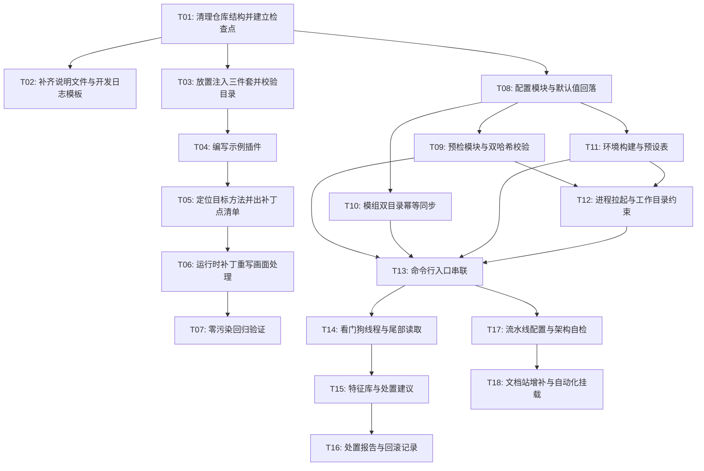

# 任务依赖图与派发顺序

## 1. 依赖图（Mermaid）

## 2. 拓扑派发顺序

1. `T01`（批次一，human）
2. `T02`（批次一，agent）、`T03`（批次二，human）、`T08`（批次四起点，agent）— 按关键链优先 `T02` -> `T03`
3. `T04`（批次二，agent）
4. `T05`（批次三，agent+human）
5. `T06`（批次三，agent）
6. `T07`（批次三，human）
7. 并行窗口 1（`batch4_modules`）：`T09`、`T10`、`T11`（均仅依赖 `T08`）
8. `T12`（批次四，agent，依赖 `T09`, `T11`）
9. `T13`（批次四，agent，依赖 `T09`–`T12`）
10. `T14`（批次五，agent，依赖 `T13`）
11. `T15`（批次五，agent+human，依赖 `T14`）
12. `T16`（批次五，agent，依赖 `T15`）
13. `T17`（批次六，agent，依赖 `T13`，建议在批次五 `T16` 验收后推进）
14. `T18`（批次七，agent，依赖 `T17`）

## 3. 并行窗口说明

- **窗口 1（`batch4_modules`）**：`T09`（`launcher/preflight.py`）、`T10`（`launcher/modmanager.py`）、`T11`（`launcher/envbuilder.py`）均只依赖 `T08`，且 `write_paths` 两两无交集，可同组并行。
- **窗口 2（批次六与批次七）**：按 `docs/PLAN.md` 第九章任务卡总表，`T18` 显式依赖 `T17`，故 `T17` 与 `T18` 保持串行（`parallel_group: solo`），在关键链 `T13`/`T16` 验收通过后依次推进。

## 4. 覆盖矩阵（`docs/PLAN.md` -> 任务卡）

| PLAN.md 章节 | 核心交付物 | 对应任务卡 |
| :--- | :--- | :--- |
| 一、计划背景与现状盘点 | 仓库基线冻结、检查点与基线哈希 | T01, T02 |
| 二、总体架构与四层职责划分 | 注入三件套放置、示例插件日志验证 | T03, T04 |
| 三、逻辑调度层设计 | 配置、预检、模组管理、环境构建、拉起、CLI | T08, T09, T10, T11, T12, T13 |
| 四、监控自愈层设计 | 看门狗尾部读取、8 条特征库、处置报告与回滚 | T14, T15, T16 |
| 五、插件体系与模组接口库规划 | 补丁点清单、模组接口库、去码插件与零污染回归 | T05, T06, T07 |
| 六、持续集成接入计划 | 四阶段流水线、三条红线、架构自检 | T17 |
| 七、文档站演进计划 | 文档站七章增补与双视口自动化审查 | T18 |
| 十二、智能体协作协议 | 协作说明文件骨架 AGENTS.md | T02 |

## 5. 自检清单（7 项全部通过）

- [x] 每卡 `acceptance` 逐条含 `id`、`cmd`、`expect`
- [x] 无依赖环、无孤立卡、无自依赖
- [x] 同并行组（`batch4_modules`: `T09`, `T10`, `T11`）内 `write_paths` 两两无交集
- [x] 所有卡 `forbidden_paths` 均包含 `src/stub_perfect.c`、`*.keystore`、`rootfs*`、游戏可执行文件与资源、外部下载源配置
- [x] 每卡均有 `rollback`
- [x] 覆盖矩阵：`docs/PLAN.md` 每个交付物均有 ≥ 1 张卡覆盖
- [x] 无范围外待确认卡，所有 18 张卡 `status: draft`

## 6. 三行摘要

1. 产出产物：`docs/tasks/TASKS.yaml`、`docs/tasks/cards/T01.yaml`–`T18.yaml`、`docs/tasks/GRAPH.md`（共 18 张 `draft` 任务卡）。
2. 关键链与并行：`T01`->`T03`->`T04`->`T05`->`T06`->`T07`->`T08`->(`T09`||`T10`||`T11`)->`T12`->`T13`->`T14`->`T15`->`T16`->`T17`->`T18`。
3. 待人工确认：审阅 `GRAPH.md` 覆盖矩阵与依赖图后，将首批可开工卡（如 `T01`）状态置为 `approved` 再派发执行。
